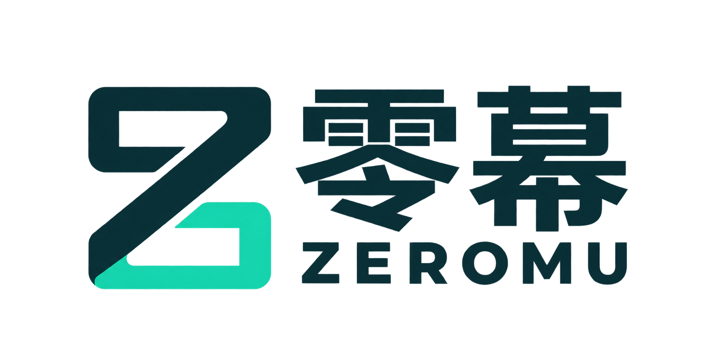
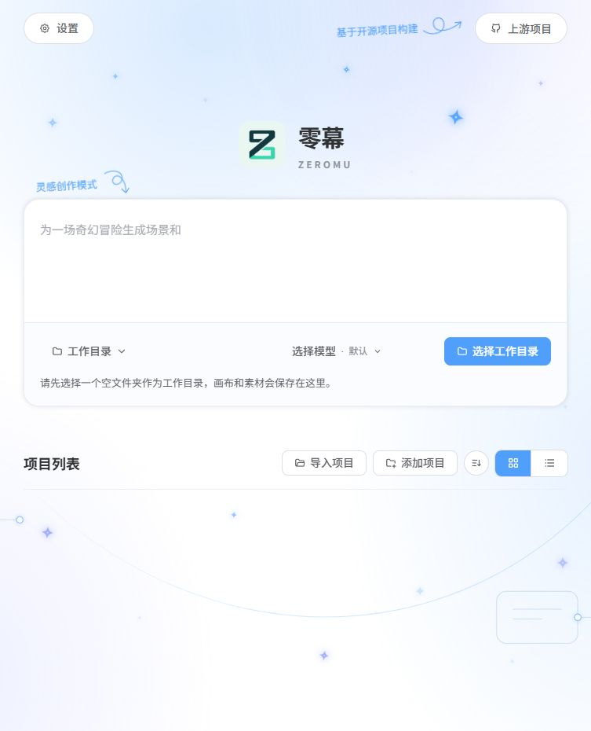

# 零幕 · ZEROMU



**从零开始，创造第一幕。**

用于 AI 影像与漫剧创作的个人工作台：在画布中组织角色、场景、分镜与生成结果，通过模型渠道连接第三方 API。

[总开发计划 plan](./docs/plan.md) · [当前进度](./docs/progress.md) · [文档目录](./docs/readme.md)

## 本地运行

项目使用 Bun。首次安装或更新前端后先构建，日常在一个终端启动前后端：

```powershell
bun install
bun run --filter '@toonflow/web' build
bun run start:local
```

前端地址：<http://localhost:5173>。首次准备画布节点时执行 `bun run dev:plugins`。

`start:local` 同时启动本地后台与前端预览，保留本机文件夹选择和项目访问能力，不监听源码变化。使用期间保持该终端运行；关闭终端或重启电脑后需重新执行 `bun run start:local`。更新代码后先停止服务，重新构建，再启动并刷新浏览器。单独启动前端仍可使用 `bun run start:web`；开发时使用 `bun run dev`，热更新可能触发整页刷新。两种前端不能同时占用 5173 端口。

## Windows 桌面版

当前优先完善 Windows x64 本地创作工具，商业 API 服务在后续阶段建设。具体安排见 [总计划](./docs/plan.md)、[验收清单](./docs/acceptance.md) 和 [技术与安全边界](./docs/architecture.md)。

```powershell
bun install
bun run prepare:desktop
bun run typecheck
bun run package:desktop
```

打包需要 NSIS；非默认位置可通过 `NSIS_PATH` 指向 `makensis.exe`。安装包输出到 `build/desktop/artifacts/`。当前产物为未签名开发验收包；本机安装与更新已有记录，最新候选、真实作品、干净机器及发行门槛仍需继续验收，范围见 [当前进度](./docs/progress.md)。

零幕使用独立标识 `local.zeromu.desktop` 与 `zeromu://` 启动协议。首次安装使用独立目录，已有旧版配置与项目不自动迁移或删除。本机后端只监听回环地址，不应作为公网 API 服务开放。

## 品牌素材

- `packages/assets/zeromuIcon.png`：透明图标。
- `packages/assets/zeromuLogo.png`：中英文组合徽标。
- `packages/assets/logo.ico` 与 `logo.iconset/`：桌面平台图标导出。
- 名称：零幕 / ZEROMU。品牌色：墨青 `#12343B`、薄荷绿 `#29D7B0`。

桌面窗口、启动画面与安装器使用零幕品牌。定制版更新需要自己的发布源，避免被上游安装包覆盖。

## 许可

本项目以 MIT 许可分发，完整许可文本与第三方组件署名见 [LICENSE](./LICENSE) 和 `packages/assets/onnxRuntimeNotices.txt`。

为兼容既有项目、插件和本地配置，`@toonflow/*` 包名、文件格式标记和内部数据标识继续沿用；桌面安装身份与外部启动协议使用零幕独立名称。TF-Router 等第三方服务仍以其真实名称显示。

## 目录与版本管理

- `apps/`：网页、后端和桌面应用。
- `packages/`：共享模块、节点、工具与正式徽标。
- `docs/`：[文档目录](./docs/readme.md)，集中维护计划、进度、验收、开发、设计和技术边界；旧记录在 `docs/archive/`。
- [开发与 GitHub 版本管理](./docs/development.md)。
- [品牌说明](./docs/branding/brand.json) 与当前界面预览：



`data/` 中的本地配置、依赖和构建产物不纳入 Git。
