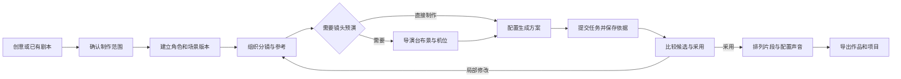
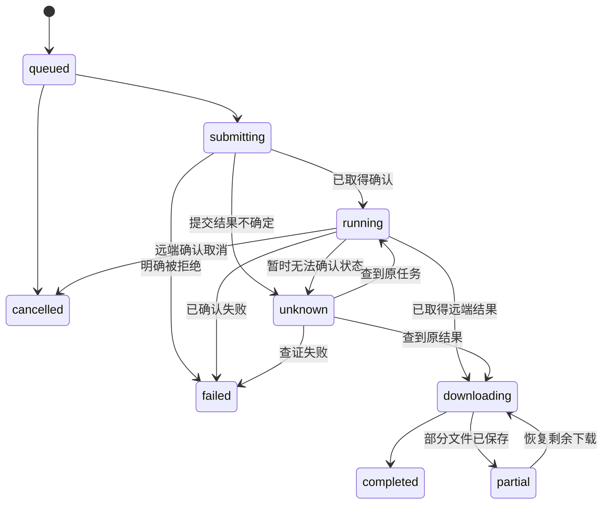

# 零幕产品完善与发布计划书

日期：2026 年 10 月 14 日  
进度更新：2026 年 10 月 22 日（第五十四批）
规划版本：1.0  
适用产品：零幕 ZEROMU  
阶段定位：Windows 本地 AI 影像与漫剧创作工具  
状态：执行中；统一任务、制作结构、工作站传递、导演机位、成片导出、完整项目包、费用预算及提示词/制作模板已接入并通过本地隔离验证；真实模型、完整示范作品与发行验收继续推进

实施记录见 [产品开发执行记录](productDevelopmentProgress.md)。勾选项仅表示对应实现及已记录的验证完成，不代表 M1 或正式发行已经全部验收。

第四十四批补齐画布持久化修复与本机隔离回归：300 节点未编辑打开及重载保持原文件，实际编辑、写入失败、重试与重开通过；文本加载失败保留原内容。2.0.14 候选构建及后续范围见 [画布保存一致性](canvasPersistence.md)。完整作品、真实渠道和正式发行验收仍待完成。

第四十五批复用冻结候选完成 2.0.13 → 2.0.14 实际安装、原生编辑/重命名与换端口重开；367 份既有文件全部保持，旧 300 节点画布正文与修改时间未变。见 [2.0.14 原生保存验收](windowsCanvasPersistence.md)。

第四十六批补齐 F11 图片/视频工作站历史专项：仅由历史引用的两张既有真实图片及一条本地 FFmpeg 视频完成归档、重启及全新数据目录恢复，8 份清单文件一致；无模型及原任务缓存时，图片解码与视频播放至结束通过。见 [工作站历史项目包恢复](studioHistoryPackage.md)。本地视频不计作真实模型视频成功，本批未新增生成请求或改动运行时代码。

第四十七批将媒体供应商加载与生成移入独立工作进程，保留宿主凭据检查、响应流、持久任务、逐项保存、用量与 FFmpeg 接口；源码、编译 HTTP 及仓库外 Bun 1.4.0 冷运行通过。2.0.15 / idgql0zyin6t 完整打包通过，第四十八批已补齐本机原生安装、内置媒体执行及正常重开，见 [原生供应商验收](windowsProviderExecution.md)。见 [供应商执行隔离](providerExecutionIsolation.md)。普通子进程不等于操作系统权限沙箱，完整插件和真实媒体验收继续推进。

第四十八批已在原隔离目录实际升级为 2.0.15 / idgql0zyin6t，原生配音与背景移除通过，独立供应商进程完成后退出，正常换端口重开恢复两项结果。升级前 369 份文件保持，重开后当前 379 份文件内容一致；基线已有画布变化与额外空草稿独立记录。见 [2.0.15 原生供应商验收](windowsProviderExecution.md)。

第四十九批已完成《迟到的回信》8 句本机配音与 32 秒声音草稿，保留字幕、逐镜头声音依据和含 8 项任务回执的完整项目包。修复了素材版本回执归档遗漏及媒体节点载入时自动填写模型、改写参数的问题；实际安装更新为 2.0.17 / 25ifo3zirucek，新恢复副本原生打开后 82 份归档文件保持，声音播放至结束，正常重开后 639 份项目文件保持。见 [声音制作与归档](comicAudioProduction.md)。画面和人工听审仍待完成，未计作完整成片；外部新增生成与支出为 0。

第五十批补齐应用 85%–150% 字号，修复制作导航遮挡焦点、页签断词、缩小窗口过渡裁切，以及成片保存和导出后的键盘焦点。成片面板在深浅主题下完成 18 组标准窗口/字号组合及 2 组补充窄窗核对；键盘保存、两次本地 MP4 导出与播放至结束通过。实际安装为 2.0.19 / m1cu5aex0c9i，464 份程序与页面资源匹配，639 份既有项目文件保持，原始字号设置恢复。见 [成片键盘与窗口记录](filmKeyboardAndLayout.md)。这些结果不替代系统 DPI、其他设备、真实模型作品或正式发行验收。

第五十一批将工具界面移入独立页面，保留当前提问提交、节点定位及复制能力，并补齐应用语言、主题和字号继承。语言修订后在深浅主题、三种窗口和三种字号下完成 18 组核对；后续修正另核对画布切换恢复与错误提示完整显示；选项、自由补充、制作表单与跳过取得实际本地回执，节点定位和键盘操作通过。Windows 2.0.20 / 1n5ckjgp6fgym 候选构建通过；本机实装仍为 2.0.19，原生整合继续验收。见 [工具界面独立页面](toolViewIsolation.md)。

第五十三批明确启用桌面页面的受限原生桥模式，完整 Windows 候选构建及 2.0.19 → 2.0.21 / 2zrk9nrq2bytz 实际安装通过。首次启动前 467 份程序与页面资源匹配，649 份项目文件及设置保持；原生首页、文件夹选择、手动历史工具卡片与节点定位通过。正常重开首页已观察，639 份原项目文件及重开前 11 份验收项目文件保持。页面权限的额外检查、重开后的工具卡片界面复核及控制台异常仍未全部验收，见 [桌面原生桥记录](desktopNativeBridge.md)。

第五十四批修复无更新源时的启动检查与 Windows 主页面残留原生通道错误，前端、桌面类型检查及完整打包通过，实际安装更新为 2.0.23 / 1rsn8e5axrea9。原生工具卡片、已答表单、节点定位及正常重开后的再次读取与定位通过；639 份原项目文件及重开前 14 份验收文件保持。工具子页面仍有两条框架错误，页面权限直接核对及完整插件隔离仍待完成。现有单元测试命令未找到测试文件，没有记为通过，见 [原生启动与重开记录](nativeStartupDiagnostics.md)。

## 1 产品目标与执行摘要

零幕面向个人创作者和小型制作工作室，提供以本地项目为中心的 AI 影像工作台。用户可以选择模型渠道，在画布中整理创意与素材，通过导演台控制镜头预演，并把采用的结果组织成可交付作品。

下一阶段的目标是让用户可靠地完成一次制作：从剧本、角色与场景准备，到镜头生成、候选比较、局部修改和成片导出。已有画布、工作站、素材库、Agent 和导演台作为实施基础，逐步统一任务、版本和引用关系。

### 核心产品决策

| 决策 | 具体安排 | 用户收益 |
| --- | --- | --- |
| 本地项目优先 | 继续以本地目录保存项目、画布、素材和制作记录 | 文件可管理，成果可迁移，长期制作有依据 |
| 模型由用户选择 | 保留自有 API 渠道，按真实模型能力展示参数 | 可以选择适合任务与预算的模型 |
| 制作流程连续 | 分镜、画布、工作站和导演台共享制作对象与结果 | 减少反复复制、找文件和重新配置 |
| 镜头控制成为重点 | 打通机位、参考素材、生成任务与镜头候选 | 能把构图意图落实到可比较的结果 |
| 可靠性先行 | 统一任务恢复、版本保存、失败处理和项目迁移 | 长时间创作中断后可以继续 |
| 每阶段交付完整场景 | 以实际完成的作品和恢复记录作为阶段依据 | 新能力可以独立使用和评价 |

### 首个完整版本的完成定义

用户在 Windows 上创建一个本地项目，使用已配置的真实模型渠道，完成一个包含 6 至 8 个镜头、2 个角色、2 个场景、约 30 至 60 秒的示范短片。这个范围用于验收，不限制产品允许的作品长度。

制作过程中，用户能够重开应用、继续已有任务、替换一个候选、修改一个角色版本并识别受影响镜头。最后可以得到可播放的 MP4、采用素材及生成依据；项目迁移到另一台机器后可以打开已有成果，继续生成时重新配置本机凭据。

### 优先投入

1. 统一工作站、画布和 Agent 的生成任务及恢复机制。
2. 建立分镜、素材版本和候选采用的共同数据基础。
3. 打通导演台到镜头生成、比较和成片导出的流程。
4. 完成真实模型、原生安装、升级和数据恢复验收。

## 2 目标用户与使用场景

### 用户范围

| 用户 | 核心任务 | 当前常见困难 | 零幕提供的价值 |
| --- | --- | --- | --- |
| 个人漫剧创作者 | 将剧本逐镜头制作成短片或连续内容 | 角色漂移、素材难找、返工后关系混乱 | 角色版本、镜头状态、参考绑定和局部重做 |
| 影像与广告创作者 | 生成具有明确构图和运镜的画面 | 提示词难以准确表达站位、构图与镜头变化 | 导演台预演、机位参考和候选比较 |
| 已有 API 的熟练用户 | 在多个渠道之间选择能力与成本 | 参数不兼容、任务中断、结果分散 | 能力明确的模型选择、统一任务与生成记录 |
| 小型制作工作室 | 在本机整理项目并交接成果 | 定稿不明确、交接缺素材、结果无法追溯 | 采用版本、项目打包和完整交付清单 |

首阶段重点服务独立完成制作的人。小团队可以通过项目包和素材包交接；实时多人编辑作为后续独立能力规划。

### 三个首批范例

- **双人对话**：验证角色外观、正反打、视线方向、对白和候选替换。
- **商品广告**：验证主体一致性、环绕或推进镜头、局部修改与多比例输出。
- **短篇漫剧**：验证剧本拆解、多个场景、连续镜头、声音和最终合成。

范例使用可合法分发的自有或授权素材。每个范例包含输入、参考、制作步骤和已知能力限制，提供可直接查看的已有结果；调用模型生成新结果时显示实际任务与费用条件。

## 3 竞品借鉴与差异化

### 公开能力对照

| 平台 | 已公开的产品重点 | 零幕的借鉴方向 |
| --- | --- | --- |
| OiiOii | 动画故事的 Agent 分工、画布并行生成、角色与场景制作、素材就地编辑 | 阶段进度可见，生成后继续修改，减少创作过程中的页面跳转 |
| LibTV | 多模型与工具库、画布、Agent、工作流分享，以及 3D-BOX 的搭景、站位和运镜 | 把导演台输出与实际生成绑定，保持专业控制与操作清晰 |
| Seko | Agent 复用剧本、角色、场景和风格，配合 Skill 支持连续内容生产 | 将跨镜头和跨集的素材引用、采用版本、制作状态沉淀到项目 |
| Pavo | 官方应用说明中的模板、图片编辑、Agent、短剧模式和素材引用复用 | 缩短首次创作路径，让旧素材成为下一次创作的起点 |

公开资料：[OiiOii 画布](https://www.oiioii.ai/features/canvas)、[OiiOii 素材编辑与 Agent](https://articles.oiioii.ai/directing-not-prompt-engineering-smart-canvas)、[LibTV 产品介绍](https://www.liblib.tv/wappro)、[LibTV 3D-BOX](https://www.liblib.tv/3d-box)、[Seko 3.0 官方介绍](https://www.sensetime.com/cn/news/seko-3-0-ai-1)、[Pavo 官方应用说明](https://apps.apple.com/us/app/pavo-ai-image-video-maker/id6759694050)。

以上描述限定于官方公布的功能。生成质量、速度、价格和成功率需要同条件比较；Pavo 的依据包含移动端更新记录，其网页版详细能力仍需单独核实。竞品宣传中的一致性和效率承诺不作为零幕的已验证指标。

### 零幕要形成的优势

**项目掌握在用户手中。** 保留可读取的项目文件和媒体目录，提供完整打包、检查与恢复。调用云端模型时，所需内容仍会发送给对应供应商；本地保存与云端调用在界面中有明确边界。

**镜头意图可以追溯。** 一次生成可以回到它使用的剧本版本、角色版本、机位、提示词和模型参数。用户能够定位问题发生在哪个环节。

**修改只推进到需要的范围。** 更换角色或镜头候选时，先展示依赖影响，再由用户选择更新哪些镜头。已采用的旧版本保留，涉及新增生成的部分显示任务范围与预算。

**工作方法可以定制。** 沿用 Skill、工具和节点扩展，让用户保存自己的制作模板。面向普通用户的入口采用创作语言，插件、协议和工具配置集中在设置中。

### 竞争判断

画布、模型列表和 3D 场景本身已经有多个产品提供。零幕的差异化需要由实际体验证明：同样的作品，用户能否更容易控制镜头、更少重复生成、更快处理返工，以及更完整地保留自己的项目。

## 4 当前能力与实施基线

这里区分源码中的能力、已有验收记录和新增规划。后续开发按最新代码复核，较早文档中的未完成描述不能覆盖较新的验收记录。

| 模块 | 当前基础 | 下一步补充 |
| --- | --- | --- |
| 画布 | 多画布、节点与连线、分组整理、保存、撤销重做、导入导出 | 分镜映射、引用关系、跨会话制作快照 |
| 生成工作站 | 图片、视频、音频参数，参考素材，历史结果与生成配置 | 与已有画布、已有镜头双向衔接 |
| 任务系统 | 工作站任务落盘、部分中断恢复、避免不确定提交的自动重提 | 接入节点与 Agent，统一进度、调度和能力提示 |
| 素材库 | 搜索、分类、标签、来源、描述、导入导出 | 稳定素材身份、不可变版本、角色参考组和使用位置 |
| Agent | 画布与文件工具、媒体生成、Skill、制作规则和确认入口 | 制作状态结构化，任务与采用结果直接可见 |
| 分镜团队 | 导演、编写、审阅的文字分镜示例 | 与实际镜头、素材和任务结合；工具权限按职责配置 |
| 导演台 | 手动布景、人偶、站位、机位、焦距、AI 动画和媒体输出 | 保存机位版本、绑定镜头、对应生成与回填候选 |
| 历史记录 | 节点历史结果、工作站参数、制作规则中的版本台账 | 并排比较、采用状态、完整生成依据和项目恢复点 |
| 后期处理 | FFmpeg 工具与媒体导出基础 | 可操作的镜头排序、截取、声音配置和成片导出 |
| 桌面交付 | Windows 构建和安装包、更新机制、独立应用身份 | 原生生命周期、真实模型、跨版本恢复和发行条件验收 |

截至现有记录，导演台已完成本机 PNG 和 MP4 输出、部分交互性能与保存恢复验收；这不代表所有机器的性能。桌面完整安装升级生命周期和真实付费模型完整流程仍按 [Windows 验收清单](windowsDesktopChecklist.md)推进。导演台最新记录见 [导演台与 API 保护](directorAndApiPlan.md)。

### 沿用现有实现

当前技术栈继续采用 Vue、Pinia、Vue Flow、Bun、Express、Electrobun 和既有 Three.js 导演台。节点、工具、供应商和 Skill 继续使用现有扩展机制；本地文件访问复用 `@toonflow/file` 和前端 `useWorkspaceFiles`。

源码中的通用能力有 Toonflow 开源基础，产品资料保留原有署名和许可。对外卖点聚焦零幕实际完善并经过验收的工作流、镜头控制和项目体验。

## 5 信息架构与页面设计

### 名称与层级

| 名称 | 含义 | 界面原则 |
| --- | --- | --- |
| 项目 | 一个本地制作目录，包含画布、素材、镜头和结果 | 用户需要选保存位置、制作范围或交付时展示 |
| 画布 | 项目中的可视化工作面 | 名称显示为画布 1 等实际名称，新建操作统一称新建画布 |
| 镜头 | 可编号、生成、比较和采用的制作单元 | 分镜视图与画布通过镜头标识相互定位 |
| 素材 | 可被多个镜头引用的角色、场景、道具、媒体或文本 | 素材身份与素材版本分开 |
| 候选 | 某次生成或导入得到的备选结果 | 用户明确采用后才进入成片清单 |
| 导演台 | 对一个场景进行布景和镜头预演的编辑器 | 从画布或对应镜头进入，返回原有制作位置 |

单画布用户可以直接开始创作；当需要多个画布或分集制作时，再逐步展示项目层级。

### 全局与项目内导航

```text
首页
├─ 继续最近创作
├─ 新建画布
├─ 图片创作  视频创作  音频创作
└─ 打开本地项目

画布仓库
└─ 项目与画布查找  重命名  导入导出

当前项目工作区
├─ 画布视图
├─ 分镜视图
├─ 资产面板
├─ Agent 面板
├─ 导演台编辑器
└─ 成片面板

公共入口
├─ 任务中心
├─ 全局素材与提示词库
└─ 模型渠道与设置
```

画布与分镜是同一批制作内容的两种视图。首期分镜可以做成工作区面板，复用现有路由和项目上下文，避免为同一对象建立两套独立页面状态。

### 画布顶部与工具栏

沿用最近确定的操作职责：

- 左上角主菜单提供回到主页、画布仓库。
- 画布名称下拉显示当前项目内的画布；标题为画布，右侧加号负责新建画布，选中项显示勾选。
- 保存状态持续可见；保存失败提供重试与可恢复信息。
- 底部创作工具提供文本、图片、视频、音频和导演台入口。
- 分镜与成片功能通过有文字的视图或面板入口提供，避免新增含义不明确的加号。
- 任务中心入口在生成期间可见，展示进行中数量和需要处理的异常。

创建、切换、生成、导出分别有明确作用域。新建画布时选保存项目；追加结果时选择目标画布或镜头；所有异步操作在开始时固定项目标识，切换页面后结果继续归属原项目。

### 主要页面职责

| 页面或面板 | 主要内容 | 主操作 | 必须覆盖的异常状态 |
| --- | --- | --- | --- |
| 首页 | 最近作品、创作入口、保存位置和必要配置提示 | 继续创作或开始创作 | 项目移动、目录不可访问、模型未配置 |
| 工作站 | 提示词、参考素材、真实模型能力、结果 | 生成，发送到已有画布或镜头 | 不支持参数、提交不确定、结果下载失败 |
| 分镜视图 | 镜头编号、剧情、时长、参考、候选和采用状态 | 生成候选或进入编辑 | 缺参考、引用已更新、采用文件缺失 |
| 素材详情 | 固定身份、版本、多视角参考、使用位置 | 创建新版或选作参考 | 文件移动、版本缺失、仍被引用 |
| 导演台 | 场景、属性、机位、动画方案和镜头绑定 | 保存机位并生成参考 | 保存失败、模型能力不匹配、导出中断 |
| 候选比较 | 两个媒体、生成依据和差异 | 采用其中一个或继续修改 | 历史参数不完整、媒体读取失败 |
| 任务中心 | 所有来源的任务、所属项目、状态、恢复入口 | 查看结果或处理异常 | 渠道失联、状态未知、渠道配置已变更 |
| 成片面板 | 已采用片段、顺序、截取范围、声音与输出规格 | 预览并导出 | 缺片段、编码失败、空间不足 |

### 视觉与交互原则

沿用现有深灰、细分隔线和线性图标，薄荷色用于主要操作和焦点，导演台以中性界面衬托三维画面。浅色主题复用同一结构。生图、视频、音频保留现有可调整宽度的左侧创作面板。

状态同时使用文字、图标和颜色表达。图标按钮提供名称、提示和键盘焦点。任务进行中保留可读状态，模型能力不支持的选项说明原因；输入草稿、选择与滚动位置在常规切换中保留。

验收覆盖 1280×720、900×650、640×700 窗口，系统或应用缩放 100%、125%、150%，以及键盘基本操作。小窗口使用面板切换，持续保持作品区和当前主操作可访问。

## 6 完整创作流程



### 从已有成果接续

用户导入定稿剧本时，保留原文版本并进入相关制作阶段；已有角色或视频可以直接登记和复用。单张图片、单段音频等轻任务继续使用工作站，只有需要组织作品时再绑定镜头。

### 生成与采用分开

生成成功表示结果已取得并保存；采用表示用户选择这个结果用于作品。文件存在、API 成功、Agent 给出评价、用户采用分别记录。Agent 没有实际查看视频或听取音轨时，不产生已完成相应质量检查的状态。

### 变更后的处理

修改角色、场景或剧本文本时创建新版本，列出引用旧版本的镜头。用户可以保留旧版、更新部分镜头或准备全部受影响镜头的新候选。已经导出的作品保持其原有版本依据。

更新引用不直接触发付费生成。需要生成时先形成具体批次，显示镜头、数量、模型、规格和可获得的费用估算；执行次数和允许范围按已有用户确认规则记录。

## 7 功能实施规格

优先级定义：P0 为可靠使用和交付基础，P1 为首个完整制作版本，P2 为提高效率的后续增强。

### F01 统一生成任务中心

**优先级：P0。基础：已有工作站持久化任务。**

工作站、画布节点和 Agent 的媒体生成统一接入同一任务服务。每个任务保存项目、来源、镜头或节点、输入快照、供应商任务号、结果文件和错误阶段。首期使用现有持久化实现扩展，任务列表按项目和媒体类型筛选，并支持从记录定位原位置。

先补统一查询与恢复，再引入可配置的每渠道并发上限。存在引用依赖的镜头按依赖执行；独立镜头可以排队并行。批次只汇总子任务状态，单个失败不会抹掉已完成结果。

取消操作按能力区分：未提交任务可以取消排队；已提交任务只有供应商支持时才显示终止生成；停止等待、终止远端任务和停止计费不能互相替代。

**验收：**三个入口均有持久化任务记录；重开应用后能查到原任务；结果不会串到后来切换的项目；提交结果不确定时不会自动新建付费任务；已保存的部分结果可以继续下载剩余部分。

### F02 分镜制作视图

**优先级：P1。前置：F01 与基础制作对象。**

首期采用可排序的镜头卡片或表格，字段包括编号、剧情、对白或声音、预计时长、角色与场景引用、生成状态、候选和采用结果。显示实际片段时长，保留与预计时长的差异。

镜头与画布节点可以互相定位。Agent 可以根据剧本提出分镜草案，由用户查看后写入；拖动镜头顺序更新制作序列，保持节点和镜头标识稳定。多集内容先用项目内的制作单元区分，每个单元有独立镜头顺序与导出清单。

**验收：**建立 8 个镜头，调整顺序并重开后顺序一致；可以定位每个镜头使用的参考与采用结果；删除分镜记录前提示其引用关系，原媒体按保留策略处理。

本机八镜头已通过把手前后插入、首尾自动滚动、取消、并发修订拒绝、单元切换与重开保序核对；八个绑定节点定位时会收起制作面板，使目标完整可见。固定参考、候选、采用与节点身份保持不变，详见执行记录第二十批。第二十一批另在 2.0.2 原生安装版验证按钮、鼠标拖动和方向键排序保存；真实触屏、系统缩放与其他原生中断场景继续按 F12/M5 验收。

### F03 角色场景与道具版本

**优先级：P1。前置：素材身份与引用索引。**

在已有素材库上增加角色、场景、道具的结构化资料。角色可以关联不同造型、参考角度和声音设定；场景保存空间与风格说明；每次采用的素材内容形成固定版本。

一个镜头引用明确版本，素材更新时显示受影响镜头。全局素材带入项目后建立本地副本或可靠的项目内引用，交付时能够归集实际依赖。素材改名不改变身份，文件位置变化可以重新定位。

**验收：**同一角色两个服装版本分别用于不同镜头；新增第三版不会改变前两版；能查出所有使用位置；导入另一个项目后引用仍有效。

本地八镜头项目已验证三版造型、直接与历史引用范围、只更新所选镜头、旧候选与采用保留，以及完整项目包恢复。镜头资料快照与实际生成输入分别记录，替换资料不会自动改画布连接或重新付费生成。全局素材带入项目、原件摘要核对与缺失文件补回已通过双项目、真实重启、界面选择原件及完整项目包专项验收，详见执行记录第十四、十七批；当前版本预览可在补回后恢复。画布原有直接拖入仍为轻任务副本，需要固定身份时使用“带入项目”。

### F04 工作站与已有画布衔接

**优先级：P1。前置：F01，绑定镜头时依赖 F02。**

将现有发送到画布扩展为追加到当前画布、选择已有画布、新建画布；存在镜头时可添加为该镜头候选。保存媒体、完整有效参数、参考版本和来源任务，进入目标后选中新增内容。

重试跳转只负责定位已经写入的结果，避免重复创建节点。使用固定项目上下文完成传递；路径、画布或节点已失效时显示可重新选择的目标。

第三十三批修复尚未生成时工作站目录被旧画布项目覆盖的恢复入口：返回首页、重新进入和重载保留上次草稿目录，显式打开项目再同步。源码界面和实际 2.0.9 安装版已验证，原生换端口重启后正文与目录保持，55 份既有项目文件摘要不变；历史任务可按状态与创建时间识别并定位。见 [草稿目录与原生重开记录](studioContextRecovery.md)。

**验收：**图片、视频、音频都能进入已有画布；生成依据与参考顺序保留；跳转失败后可找到已保存内容；重复点击不会重复追加。

### F05 候选比较与采用管理

**优先级：P1。前置：F01，版本引用依赖 F03。**

图片支持并排与缩放比较，视频支持对齐时间位置进行比较，音频支持逐个试听。同时显示模型、提示词、参数和参考差异。不同视频时长分别标注，超出较短视频范围时不伪装同步。

采用操作固定一个具体媒体版本；改提示词生成新候选时保留旧结果和旧生成依据。历史数据没有参数时显示未知，不拿当前设置补作历史。项目恢复点与短期撤销分别提供。

**验收：**生成或导入三个候选后采用一个，再切换采用并恢复前一次选择；每个候选都能找到自己的生成依据或明确的缺项；重开后采用状态一致。

### F06 导演台与镜头生成衔接

**优先级：P1。前置：F02、F03、F04。**

每个机位关联镜头，可保存相机、焦距、画幅、取景时间、场景版本和动画方案。截图或动画输出后，为对应镜头创建参考素材版本，配置真实模型支持的输入模式，再提交生成任务。

首期优先实现机位截图作为参考图或首帧，以及模型支持时的动画视频参考。多机位、首尾帧、姿态或深度等其他控制方式按供应商实际能力扩展。三维相机参数可以用于参考与提示描述，其最终遵循程度由生成结果验证。

将生成结果回填为该镜头候选，保留与原机位的关联。场景或机位变化后标记参考需要更新，已采用结果继续绑定旧快照。

**验收：**布置一个双人场景，保存三个机位，分别生成参考并提交对应任务；每个候选都能回到所用机位；修改一个机位时只标记相关引用。

### F07 轻量成片面板

**优先级：P1。前置：F02、F05。**

按镜头顺序汇总已采用视频，提供入点、出点、原声开关、旁白和背景音乐音量、整体画幅、分辨率和帧率。预览与导出使用同一编辑决定清单，复用 FFmpeg。

首期采用顺序拼接和必要的裁切、缩放、音频混合。交付 MP4、采用素材索引和导出设置。字幕首期支持用户确认的文本与时间范围导入和导出；自动转写、精细字幕动画与高级转场进入后续增强。

每次导出固定输入版本，写入新输出文件；中断后的部分文件单独标记，原素材保留。片段缺失、超出时长、音轨异常和空间不足在可检测的最早阶段提示。

**验收：**6 至 8 个片段完成重排、裁切和音量设置后导出可播放 MP4；按选定帧率量化后的编辑清单核对视频流，总时长误差不超过一帧；音频编码填充单独核对，关键位置试听无意外静音与明显不同步。

第五十批补齐成片面板的窗口、应用字号和键盘操作：20 组深浅主题组合、保存重载、本地导出与键盘播放通过；实际安装更新为 2.0.19。见 [成片键盘与窗口](filmKeyboardAndLayout.md)。系统 DPI、其他设备和真实作品质量仍按原门槛验收。

### F08 模型配置与生成费用

**优先级：P0 完成能力提示，P2 完成费用汇总。**

保存配置、模型列表拉取、连通性检查和真实生成分别展示状态。参数控件来自已支持的模型能力，首尾帧、音频参考、时长和分辨率不通过猜测开放。

费用记录区分供应商返回的实际用量、按公开或用户维护单价计算的估算，以及未知费用。估算保存币种、计费单位、单价来源和更新时间；最终以供应商账单为准。预算限制控制新增提交，对已提交任务的实际扣费按渠道能力处理。

第三十四、三十五批重新核对 Agnes 目录与公开单价：标准版 4 秒视频在预扣阶段因额度不足返回 403，另一次独立 Flash 空镜仍返回队列已满 503，无 video_id；两类不可恢复提交的本地继续接口均拒绝且原任务文件保持，未代发生成。累计六次真实请求中两张图片成功、标准视频一次拒绝、三笔 Flash 视频待核对，仍无成功视频或已核对实付。人民币 10 元总上限保持，估计占用 0.445 美元；暂停新增视频尝试，待渠道额度或容量可用后继续成功及恢复验收。见 [渠道实际记录](agnesChannel.md)。

第二十九批增加 Windows 系统配音独立渠道：实际列出本机音色，生成两条中文 MP3 与一条英文 WAV，并完成保存失败后的重启恢复和无渠道独立目录播放。零元估算和跨运行环境错误信息的缺陷已修正。仅报告字符用量，不伪造云渠道账单；原生整合和声音质量验收继续推进。详见 [系统配音说明](systemSpeech.md)。

现有制作 workflow 集中优化 Seedance。保留该专项方案；面向其他模型时增加独立规则分支，让模型选择与制作方法一致，并查询真实可用模型。

已加入实际视频模型的只读规则核对入口：Seedance 2.0/2.5 专项正文保留，其他模型使用独立通用视频资料；显示名称不替代模型身份，规则不扩大能力或生成授权。隔离工具加载、权限及真实 Agnes 目录核对见第十三批执行记录。

第二十三批补齐 Agnes 明确型号的官方协议映射，完成真实 1K 文生图和单图参考生成、三项任务重启保留及待核对提交防重。视频实际提交返回队列已满的 503，未取得 video_id，保留预估占用并禁止自动重发；音频与实际账单仍未核对。公开地址视频参考已做协议检查，本地视频参考尚未接通上传。范围与操作限制见 [Agnes 渠道说明](agnesChannel.md)；本批源码尚未整合进 2.0.2 安装包。

第二十四批生成包含该适配的 2.0.3 内部包并复现原生草稿随端口变化丢失。第二十五批将正文、参数和参考文件持久化到项目，整合为 2.0.4，实际完成 2.0.3 → 2.0.4 更新；原生编辑保存、关闭重开后端口从 58598 变为 52006，正文、1K、3:4 与真实 PNG 参考恢复，草稿摘要一致。当前来源的旧版缓存迁移、并发冲突、损坏读取及完整项目包恢复也已验证；其他历史端口中的旧缓存尚未自动取回。该修复不扩大真实视频、音频或账单验收范围。

**验收：**错误地址、失效凭据、不支持的参考类型和超出能力的参数有明确反馈；同一批次能看到执行范围，未知费用不会显示为零；更换模型后重新核对输入与授权范围。

### F09 常用素材编辑

**优先级：P2。前置：F03、F05。**

先提供本地裁剪、旋转、尺寸调整，再接入有真实支持的蒙版局部重绘、扩图或背景移除。编辑保存为新候选；原图、选区、参数和结果保留关联。

本地部分已接入 PNG、JPEG、WebP 候选的裁剪、90° 倍数旋转与尺寸调整，复用 FFmpeg/ffprobe 配置；固定原图、新版本、父候选、比较、明确采用与项目包恢复已通过隔离文件及界面验证。第三十一批接入实际 BiRefNet 本机背景移除：生图工作台与镜头编辑入口已生成透明 PNG，原图、父候选、来源版本和任务记录保留关联；排队取消、保存失败后的重启恢复和独立目录项目包恢复已通过。第三十二批完成实际 2.0.7 → 2.0.8 安装更新，既有项目文件摘要保持；安装版已实际生成并通过原生图片另存为覆盖、拒绝覆盖与取消。范围见[本机背景移除](backgroundRemoval.md)与[安装版验收](windowsBackgroundFiles.md)。蒙版局部重绘与扩图仍未实现，背景移除其他样本质量继续验收，F09 整体验收继续推进。

第二十三批实际通过 Agnes 图片参考修改雨衣颜色，原图保留，但嘴形、口袋和局部线条出现额外变化。该结果仅作为参考生成质量证据，不替代蒙版或严格局部保真编辑验收。

**验收：**完成一次局部修改后可比较原图与结果，并将新版用于指定镜头；模型不支持相应编辑时给出能力说明。

### F10 提示词和制作模板

**优先级：P2。前置：首个完整制作流程。**

扩展当前提示词库的个人新增、编辑、收藏、标签和变量填充。制作模板关联输入要求、推荐流程和样例项目；模板中的推荐模型映射到用户实际可用渠道。

首批以双人对话、商品广告和短篇漫剧三个范例为重点。用户可以从实际完成的项目保存模板，模板导出移除凭据和非必要私有内容。

个人提示词的新增、编辑、收藏、标签、变量填充、归档恢复与独立文件导入导出已通过隔离服务和界面验证。制作模板已接通输入要求、推荐流程、三类结构范例、固定参考版本、已配置模型映射、实际完成单元提取、可审阅导出及双项目独立应用，并通过服务重启、快照和完整项目包恢复核对。使用说明见 [个人提示词库](promptLibrary.md) 与 [制作模板](productionTemplates.md)。这些实现已整合进 2.0.2 安装包；范例不包含生成成品，真实模型质量、完整作品与模板原生交互仍按 F12/M5 验收。

**验收：**用户修改模板并保存后，重开应用仍可复用；导入到另一个项目时生成独立对象，不覆盖原项目。

### F11 项目打包与恢复

**优先级：P0 完成数据保护设计，P1 完成完整项目包，P2 优化大型包。**

项目包包含制作记录、画布、实际引用的媒体、版本和清单。API Key 留在本机凭据系统。导入先校验路径、文件、版本和依赖，再写入独立目录；缺少模型或插件时允许查看已有成果，并提示继续编辑所需能力。

第二十九批实际音频迁移发现仅在工作站历史中保存的结果遗漏，已将三类工作站历史及其媒体、任务依据接入归集。三条实际音频在独立目录逐文件摘要一致，停用渠道后仍可播放。第四十六批补齐图片与视频专项：空制作记录中仅由历史引用的两张既有真实图片、一条本地 FFmpeg 视频和两份只读图片任务依据完整打包；同数据重启及全新数据目录恢复后，8 份文件一致，图片可解码，视频实际播放结束。目标无模型和全局任务缓存，提示重新配置生成渠道；遗留视频原无任务或生成参数，保持原字段。详见 [工作站历史项目包恢复](studioHistoryPackage.md)。真实模型视频、另一台机器和完整作品仍按 M4/M5 验收。

当前画布 Base64 JSON 导出继续兼容。大型项目逐步使用清单加二进制文件的归档方式，控制内存占用、支持取消和空间检查。素材回收依据全部画布、历史版本、任务、采用记录和导出记录的引用决定。

**验收：**在独立目录或另一台机器导入后，画布、采用状态和媒体可打开；损坏包导入失败不会破坏已有项目；项目包不包含 API Key；生成凭据需在目标机器重新配置。

300 混合节点与 1.20 GiB 可解码媒体已完成本机规模记录、实际大包导入导出与部分写入取消，图片/视频缩略图和原件按需播放已接入。300 节点的结构加载耗时仍需进一步归因与优化，继续优化；详见执行记录第十八批及 mediaScale.md。

第三十六批已针对隐藏视频浮层完成实际 CPU 归因，只将音量浮层和截帧菜单改为使用时创建；固定视口下隐藏浮层 62 → 26、滚动条 20 → 2，300 节点保持，实际播放、音量键盘操作、截帧、撤销及重开通过。单次前后导航的样式重算累计 1.620 → 0.563 秒，不作为稳定打开速度结论。300 份既有文件摘要不变；交互中的空编辑器规范化和派生连接坐标变化单独留痕。当批仅在源码及隔离节点包验证，第三十七批已整合进实际安装的 2.0.10；其他布局、插件挂载和性能条件继续推进，详见 [规模性能记录](mediaScale.md)。

第三十七批经真实 Windows 文件选择框上传 1292011669 字节项目包，并在新目录恢复。首次打开前全部 303 份清单文件摘要匹配；原生播放、静音、首帧截取、撤销和正常换端口重启后保持 300 节点、25 条连接与 200 份原媒体。现有默认模型/参数初始化、连接派生坐标及视口变化已单独记录，不宣称画布 JSON 字节未变。没有据不完整观察报告上传耗时或完整应用内存，见 [原生规模恢复](windowsScaleRecovery.md)。

### F12 桌面发行与首次使用

**优先级：P0。与 F01 并行推进。**

沿用 Windows x64、Electrobun、独立应用身份和已有更新机制。首次使用依次完成打开或创建保存位置、配置渠道、确认模型能力、执行第一项创作；中途失败保留草稿。

按照现有清单完成安装、启动、关闭重开、WebView2 环境、卸载保留数据、跨版本更新、中断恢复、发布签名和自有更新源。依赖兼容与插件执行边界沿用既有专项记录逐项处理。

**验收：**干净 Windows 环境与已有旧版本环境均可完成既定流程；更新失败后能继续使用原版本或按说明恢复；项目目录和用户数据保持可访问。

第二十一批已生成整合版 2.0.2，完成本机 2.0.1 → 2.0.2 应用内更新、内置资源同步、用户修改技能保留、同构建重装和默认卸载数据保留。安装版服务完成六片段项目包的独立目录恢复，并在原生窗口读取剪辑和播放已有成片。第二十二批另完成新版服务已启动、首页缺失时的实际 120 秒超时回退：旧技能全程保持，旧插件恢复，原生旧版可继续新建节点并保存。第三十批在实际安装版生成两条本机配音，2.0.7 完成原生音频另存为及取消、正常重开保留五条历史，并经原生文件窗口上传完整音频项目包、选择恢复目录和打开独立恢复结果。第三十二批实际安装更新至 2.0.8，25 份既有项目文件摘要保持，安装版完成本机背景移除和原生 PNG 另存为的覆盖确认、拒绝及取消，原生对话框打开期间宿主仍可响应。范围见 [原生文件验收](windowsNativeFiles.md)与[2.0.8 安装版记录](windowsBackgroundFiles.md)；其他系统缩放、干净机器、跨设备、超长路径和完整发行条件仍待验收。当前产物未签名、未公开发布。

第三十三批另完成同一隔离安装 2.0.8 → 2.0.9，版本登记一致、55 份既有项目文件摘要保持；原生目录框选择未生成草稿后，首页返回及换端口重启恢复正文和目录，历史失败记录可定位。见 [2.0.9 草稿目录验收](studioContextRecovery.md)。此项不扩大上述干净机器、跨设备、系统缩放与正式发行的验收结论。

第三十七批实际升级至 2.0.10 / 39c19dswblmrv，同一交互上下文登记与资源同步正确，56 份既有项目文件摘要保持，旧未生成草稿仍在。1.20 GiB 项目包的原生文件选择、恢复及重启后的 300 节点视频操作通过，详见 [2.0.10 安装验收](windowsScaleRecovery.md)。本机候选仍未签名、未公开发布，其余发行条件保持原验收要求。

第三十八批处理原九组依赖告警，当前源码锁文件审计为 0 组，163 条路由生成文件字节保持；MCP 2.2.0 实际 stdio → HTTP 的工具/资源、文件读写、参数拒绝及鉴权通过。公式/图表改用应用内依赖和字体，实际拦截公共 CDN 后仍可预览。类型及构建通过，新桌面候选与安装结果分别记录，见 [依赖维护](dependencyMaintenance.md)。[插件执行契约](pluginExecutionBoundary.md)已核对，进程隔离本身尚未实现，完整发行门槛保持。

第三十九批已实际完成 2.0.10 → 2.0.11 / 2gju0obkclvk5，同一交互上下文登记、安装资源及原生版本吻合；使用安装目录自带 Bun/stdio 连接原生宿主读取原项目成功。原生公式和图表正常重启后保持，旧 300 节点画布及全部 363 份既有项目文件摘要保持；MCP 临时访问恢复关闭，见 [2.0.11 实装验收](windowsDependencyIntegration.md)。本机结果不替代其余设备、系统 DPI、创作者试用、插件隔离和正式发布条件。

第四十批已将工具配置保存和启用时的模块加载及 validateConfig 移到独立 Bun 进程，5 秒截止、异常退出清理、失败状态保留与实际编译 HTTP 通过；仓库外、无 node_modules 的 Bun 1.4.0 冷运行及实际桌面业务入口布局验证通过。范围见 [配置校验隔离](pluginConfigIsolation.md)。第四十一批已补齐 [2.0.12 原生安装](windowsToolProcessIntegration.md)、配置保存与重启保留、恢复原值和安装版接口验证，全部 363 份旧项目文件摘要保持。

第四十二批源码已接入 Agent、MCP 与团队工具的独立加载、创建、执行及回调，保留宿主 SDK 文件队列和持久媒体能力；八个实际插件、文件并发与取消、原生 FFmpeg 流、进程树清理、46 个 MCP 工具及仓库外 Bun 1.4.0 冷调用通过，见 [执行隔离实现](pluginExecutionIsolation.md)。第四十三批补齐宿主反射与能力访问边界加固，并实际安装为 2.0.13 / 1yh6hryb6dxfa；安装目录自带 stdio、隔离 SDK 文件及技能工具、FFprobe、真实画布回调、跨项目拒绝、取消清理和原生重开通过，见 [安装版联合验收](windowsToolBoundaryIntegration.md)。安装后首次打开前 363 份旧文件保持；原生交互后 362 份及原媒体保持，工作画布的运行态字段与派生坐标变化、首次 4 字节未精确归因的差异单独留痕。第四十七批已将供应商模块加载及生成闭包移入独立进程，宿主保留明确业务能力，源码、编译 HTTP 和仓库外冷运行通过，见 [供应商执行隔离](providerExecutionIsolation.md)。自定义同步钩子兼容、真实 Agent/团队/A2A 模型联合交互与界面边界继续处理，不将普通用户进程扩大为操作系统沙箱、完整隔离或正式发行完成。

第五十一批补齐普通浏览器中的工具界面独立页面与当前记录能力范围，18 组主题/字号/窗口、提问回执及节点定位通过，2.0.20 候选完成构建。见 [工具界面独立页面](toolViewIsolation.md)。第五十四批已实际安装 2.0.23，并补齐原生卡片、已答表单及正常重开后节点定位；主页面启动控制台无消息，工具子页面仍有两条框架错误。页面权限直接核对、该兼容问题、节点界面与自定义同步钩子继续验收，见 [启动与重开记录](nativeStartupDiagnostics.md)。

## 8 数据关系与技术实施

### 制作对象

| 对象 | 核心字段 | 约束 |
| --- | --- | --- |
| Project | projectId、schemaVersion、名称、画布索引、制作单元索引 | 身份与绝对目录分开，移动目录后可以重新绑定 |
| Sequence | sequenceId、名称、shotIds、目标规格 | 表达短片、集或制作段落，顺序由标识列表维护 |
| Shot | shotId、剧情版本、预计时长、referenceIds、candidateIds、adoptedCandidateId | UI、画布和 Agent 共同操作同一镜头 |
| Asset | assetId、类型、名称、versionIds | 改名不改变身份，删除需核对引用 |
| AssetVersion | versionId、相对文件路径、内容摘要、来源、父版本 | 已用于生成或采用的版本内容固定 |
| GenerationTask | taskId、提交标识、source、输入快照、providerTaskId、状态、结果 | 一次提交对应一个稳定标识，恢复查询不创建新提交 |
| Candidate | candidateId、shotId、taskId、媒体版本、生成依据 | 手动导入结果可以没有 taskId，来源明确 |
| DirectorShot | directorShotId、sceneVersion、cameraSnapshot、referenceVersionIds | 保存使用时的场景和机位快照 |
| EditDecision | 镜头顺序、候选版本、入出点、声音设置、字幕、输出规格 | 预览与导出使用同一份决定 |
| ExportRecord | exportId、编辑快照、输出文件、实际时长、状态 | 采用变化不修改旧导出依据 |

字段为规划模型，实施时合并现有等价字段。首期优先复用文件与索引，达到明确的查询或并发瓶颈后再决定是否引入数据库。

### 权威数据与界面同步

媒体文件保存实际内容，项目记录保存关系、版本和采用状态，画布保存布局与引用。一个镜头的制作状态由项目记录确定，画布节点和分镜列表呈现该状态；Agent 的文字说明或临时输出不会直接覆盖已采用记录。

Agent 通过现有工具体系调用明确的读取与变更能力。候选提案、执行结果和用户采用有不同记录。保留现有 Markdown 制作台账的阅读价值，但其与结构化状态的同步方向明确，避免出现两份互相竞争的有效状态。

### 任务状态与恢复



每个状态保存发生阶段与可恢复方式。网络超时先判断发生在提交、轮询还是下载：轮询恢复使用原任务号；下载恢复使用已取得结果；提交结果未知时优先核查原请求。供应商支持幂等键时传递稳定提交标识，缺少支持时不能承诺完全避免远端重复扣费。

本地校验失败、鉴权失败、限流、远端失败、状态未知、下载失败和保存失败分别记录。日志包含可用于排障的任务标识，屏蔽凭据，并控制提示词和素材内容的默认记录范围。

### 数据兼容与迁移

1. 读取现有项目并检查文件结构；旧数据没有新增字段时按可确认信息建立索引。
2. 写入新结构前保存可恢复备份，记录 schemaVersion 和迁移步骤。
3. 迁移写入采用临时文件及原子替换；失败保留原件并报告具体步骤。
4. 旧媒体缺少参数或来源时保留未知状态，不从当前模型配置推断。
5. 旧版应用遇到不支持的项目格式时应明确阻止危险覆盖；回退使用迁移前副本。
6. 项目移动后重新关联目录，运行中的任务保留原归属；存在活动写入时暂缓迁移。

单文件原子写入不能替代多文件一致性。涉及媒体与索引的操作采用可恢复顺序：先保存不可变媒体或版本，再原子提交关系记录；启动时识别未完成操作和未登记文件，保留可恢复证据。

### 主要代码落点

| 工作 | 优先复用的位置 |
| --- | --- |
| 统一任务 | `apps/server/src/utils/media/tasks.ts`、`routes/ai/media/tasks`、`utils/media/generation.ts` |
| 节点与 Agent 接入 | `packages/nodeScaffold/src/nodeAi.ts`、`apps/server/src/agent/tools/index.ts` |
| 工作站衔接 | `apps/web/src/pages/studio/useStudio.ts` 与 `index.vue` |
| 画布与分镜关联 | `apps/web/src/pages/workspace`、画布节点工具和项目文件入口 |
| 素材版本 | `apps/web/src/pages/assets/materialCollection.vue`、服务端资产元数据模块 |
| 候选比较 | `packages/nodeScaffold/src/components/mediaHistory.vue` 与工作站历史记录 |
| 导演台关联 | `packages/nodes/director3dNode` 的场景、机位、方案和导出模块 |
| 成片与媒体处理 | 现有 FFmpeg 工具、宿主桥接与新的项目成片面板 |
| 项目迁移 | 现有画布导入导出、工作区文件入口和桌面数据目录机制 |

新增文件、目录、字段与自有组件名称遵循仓库小驼峰规范。实施前核对调用方，保留兼容读路径并逐步收敛生成入口。

## 9 开发阶段与排期

### 估算前提

以下为一名熟悉当前项目的全职开发者完成设计细化、实现、集成和阶段验收的初步估算，产品负责人每周提供一次集中反馈。按每周 5 个工作日计算，复用现有代码，首期以一种真实图片渠道、一种视频渠道和一种音频渠道完成验收样本。

正式投入以阶段交付和实际问题修正估算。供应商等待、发行资源采购与用户反馈等待属于日历时间，不能由开发人日精确预测。

### 里程碑

| 阶段 | 工作范围 | 工作量估算 | 依赖 | 交付与退出条件 |
| --- | --- | --- | --- | --- |
| M0 明确基线 | 固定范例、验收机器、支持渠道；确认字段、页面职责和迁移方式 | 3 至 5 人日 | 当前仓库 | 范例可打开；功能清单、关键状态与数据关系可供实现 |
| M1 任务与可靠性 | F01、F08 能力提示、F11 数据保护基础；启动 F12 原生验收 | 8 至 12 人日 | M0 | 三入口共用任务；重启与不确定提交可处理；旧项目可打开 |
| M2 制作结构 | F02、F03、F05 的候选与采用记录、基础项目快照 | 10 至 15 人日 | M1 | 8 镜头可管理；角色版本影响可见；采用结果可恢复 |
| M3 镜头工作流 | F04、F05 比较界面、F06；确定模型规则分支 | 8 至 12 人日 | M2 | 工作站和导演台结果进入指定镜头；可比较并采用 |
| M4 成片与交接 | F07、F11 完整项目打包 | 8 至 12 人日 | M3 | 示范短片可播放；项目可迁移；生成与导出依据完整 |
| M5 内测与发行 | F12 收尾，真实渠道回归、跨版本更新、用户试用和问题修复 | 6 至 10 人日 | M1 至 M4 | 发布门槛达成，剩余问题有明确严重性与处置 |

合计为 **43 至 66 人日**。增加约 20% 至 30% 的集成与返工余量后，建议按 **52 至 86 人日，约 11 至 18 个全职工作周**安排。这是规划区间，M0 结束后根据实际代码与渠道重新估算。

2026-10-22 按当前实现与验收缺口重新估算：测试版收尾约 1–2 周；M0–M5 完整发布验收约 4–6 周，目标窗口为 2026-11-19 至 2026-12-03；包含 P2 后续增强合计约 6–10 周。此为条件性排期，不是承诺：真实视频/云音频渠道和预算、设备、试用者及签名发行资源尚未齐备，缺失期间相应完成日期顺延。

M5 前的阶段均产出可内部使用的增量版本。P2 素材编辑、费用报表、模板扩展、大型项目优化在 M5 后单独排期，不计入上述工作量。

### 依赖顺序与资源分工

- 产品负责人确认首批用户、范例、采用标准和取舍，每周只安排一组明确的阶段目标。
- 开发负责人维护数据模型、任务入口和兼容性，同时记录实现与验收证据。
- 创作者试用者完成指定作品，记录停顿、失败恢复、重复操作和返工情况。
- 条件允许时，界面设计与原生环境验收可以分工；共享的数据结构先确定，再并行开发界面，避免相互改动同一核心模块。

后期范围变化按新增工作量评估。对数据丢失、重复提交、无法恢复和核心流程中断的修复优先进入当前阶段；其他功能进入后续清单。

## 10 验收场景与质量门槛

### 场景清单

| 场景 | 操作 | 通过条件 |
| --- | --- | --- |
| 首次使用 | 安装、创建保存位置、配置渠道、生成并保存结果 | 能完成第一项创作，中途失败不丢输入 |
| 重开继续 | 提交任务后关闭界面，再重开应用或后台 | 原任务可识别；按渠道能力恢复或明确待核对 |
| 切换项目 | 在 A 中提交，在 B 中继续编辑 | A 的结果和状态不会写入 B |
| 模糊提交 | 提交时网络中断或响应丢失 | 状态保留为未知；不会无依据自动重新生成 |
| 部分完成 | 多个结果中有文件下载失败 | 已完成文件保留；可仅取回缺失部分 |
| 版本替换 | 更新角色版本并选择受影响镜头 | 原采用记录完整，影响范围可见 |
| 导演台衔接 | 三个机位进入三个对应镜头 | 参考与结果归属准确，能回看原机位 |
| 局部返工 | 替换一个镜头的采用候选 | 成片使用新版本，其余镜头保持原采用 |
| 成片输出 | 排序、裁切、加声音、导出 | 输出可播放，规格、时长和声音符合清单 |
| 项目交接 | 打包后导入独立机器或目录 | 画布、媒体、采用关系可读；凭据未打包 |
| 更新恢复 | 旧版本升级，模拟下载或安装中断 | 原版本或备份可恢复，项目数据可访问 |
| 大项目 | 打开约 300 节点的项目和约 1 GB 的素材包 | 记录时间、内存和交互；取消与失败有可恢复结果 |

大项目规模属于建议验收样本，M0 需确认参考机器、媒体分布和窗口环境。重媒体统一采用缩略图与按需加载，避免同时解码全部视频。

### 发布门槛

- [ ] 核心场景全部完成，有实际结果、日志或屏幕记录。
- [ ] 无已知会导致项目不可恢复损坏、原素材误删或错误跨项目写入的缺陷。
- [ ] 应用不会把提交不确定自动当作可安全重试，不伪装远端取消或停止计费。
- [ ] 真实图片、视频、音频渠道各完成成功、失败与恢复场景；支持范围明确。
- [ ] 旧项目读取、迁移备份、项目导出导入和升级恢复完成。
- [ ] 首次使用、键盘操作、不同窗口与缩放下的关键流程可用。
- [ ] 干净机器安装、原生启动、更新源与发布身份符合既定发行要求。
- [ ] 影响创作的已知限制可在相关功能处找到说明。

验收遵循仓库规范，不新增测试文件或测试框架。后续实施按改动运行类型检查、构建、隔离数据的必要接口验证与人工界面检查，真实付费生成按具体渠道和预算执行。

### 建议指标

以下是首轮目标与观察指标，需在 M0 固定统计口径，属于计划目标。

| 指标 | 口径 | 首轮目标或用法 |
| --- | --- | --- |
| 首次独立完成率 | 5 至 8 名试用者中，不需开发者操作即完成第一项生成和保存的比例 | 建议达到 80%，同时列出逐人结果，保留小样本限制 |
| 首次操作时间 | 已有有效渠道凭据后，到完成生成提交的主动操作时长 | 建议中位数不超过 15 分钟；供应商生成等待单独统计 |
| 任务可追踪 | 已发起的媒体生成中，具有可查询持久化记录的比例 | 核心验收场景为 100% |
| 恢复处理覆盖 | 所有预设中断场景中，能恢复或明确标记待核对的比例 | 核心验收场景为 100% |
| 生成可用率 | 用户采用候选数与已生成候选数，按内容类型和模型分别统计 | 先建立基线，再判断提示词、参考与导演台是否带来改善 |
| 单个采用镜头成本 | 可确认的相关生成支出除以采用镜头数 | 实付、估算与未知部分分开记录 |
| 局部修改耗时 | 用户提出修改到重新采用的主动操作与等待时间 | 分别记录，比较阶段前后的变化 |
| 交互与性能 | 同机同数据下记录打开时间、拖拽延迟、长任务、内存与导出时间 | M0 定基线；新增功能出现明显回退时分析原因 |

供应商失败和应用失败分开统计。媒体生成完成率不能直接当作作品质量，累计素材时长不能当作最终成片时长。

## 11 竞品与自身效果验证

选择双人对话、商品广告、短篇漫剧三个任务，保留相同的原始需求、素材与输出规格。每次记录平台日期、可用模型、设置、输入、生成次数、费用与人工操作。

比较分为两个口径：共同支持的模型与参数用于比较工作流效率；各平台的推荐完整流程用于比较用户实际得到的体验。两类结果分别报告，避免把模型变化误判为产品差距。

| 维度 | 记录内容 |
| --- | --- |
| 上手 | 配置步骤、首次提交时间、需要外部帮助的位置 |
| 一致性 | 角色、服装、道具、空间、视线和跨镜头衔接 |
| 可控性 | 构图、站位、焦距意图和运镜是否实现 |
| 返工 | 改一个角色或镜头需要多少操作，是否影响无关结果 |
| 可靠性 | 切换页面、重开、异常中断后能否继续 |
| 成本 | 采用前的全部生成尝试、可确认支出和等待时间 |
| 交付 | 成片、素材、参数与项目能带走多少，迁移是否完整 |

每个平台的测试次数由预算决定，同一场景保留相同的最大尝试次数。保留失败和弃用结果；单次最佳结果不能代表平均质量。需要登录或付费的验证作为后续授权验收工作安排。

## 12 资源与费用安排

### 成本组成

| 成本 | 计算方式或安排 |
| --- | --- |
| 开发投入 | 52 至 86 人日乘以团队实际综合日成本；兼职按实际可投入时间换算日历周期 |
| 真实模型验收 | 各任务的图片数量、视频秒数、文本用量、音频用量乘以实际渠道单价，并计入有收费的失败与重做 |
| 发布资源 | 代码签名、更新源、带宽与存储按实际供应商报价确定 |
| 设备与兼容验证 | 至少包含开发机、干净 Windows 环境和一台不同配置设备，可采用已有设备 |
| 内测支持 | 问题记录、用户反馈、说明与修复时间已部分计入 M5；扩大用户规模后重新估算 |

实际单价、币种和团队成本尚未确定，因此使用公式安排预算。验收前设定每种媒体及每个范例的花费上限，记录已用和待执行任务；预估达到上限时缩小批次或调整范例。

### 预算分配原则

优先保障真实完整流程、故障恢复和项目交付验证。图片、视频、音频分别建立消耗记录，避免只统计成功结果而漏掉重试。先使用短时长和必要分辨率验证流程，再按最终交付规格验证质量。

## 13 风险与处理方式

| 风险 | 可观察信号 | 处理方式 |
| --- | --- | --- |
| 单人开发范围过大 | 同时存在多个未收尾页面，里程碑反复延后 | 每阶段只交付对应完整场景，P2 单独排期 |
| 渠道行为不一致 | 任务号、轮询、取消或计费含义不同 | 为每个适配器声明能力，分别验收；未知状态保留待核对 |
| 项目迁移破坏旧数据 | 新字段或路径关系无法被旧版本理解 | 版本号、备份、可恢复写入和旧项目样本验收 |
| 制作记录与画布不同步 | 同一镜头出现多个有效采用结果 | 项目记录作为制作状态依据，界面与 Agent 通过统一操作更新 |
| 自动化修改扩大范围 | 更新角色引发无关镜头变化 | 固定引用版本，展示受影响范围，再执行具体批次 |
| 导演台约束未被模型遵循 | 构图或动作与预演相差明显 | 按模型测试支持方式，保存对比证据，提供可用的参考模式 |
| 媒体导致性能下降 | 视频同时解码、Base64 打包占用过大 | 缩略图、按需加载、分批读写和文件归档 |
| 发行或更新失败 | 安装受阻、下载中断、更新后启动异常 | 干净机器、跨版本演练、更新完整性验证与恢复说明 |
| 费用信息不可靠 | 缺报价、失败扣费不透明 | 区分实付、估算与未知，使用实际账单核对 |
| 功能优势未被用户感知 | 用户仍主要在外部工具完成制作 | 用三个范例记录外部跳转与返工，优先处理高频断点 |

## 14 内测与后续产品发展

### 内测安排

M1 起由开发者和产品负责人使用隔离样例验证恢复；M3 邀请少量有创作经验的用户验证镜头与返工流程；M5 建议组织 5 至 8 名目标用户完成指定范例及一个自选小项目。

反馈按阻断制作、损坏数据、增加重复操作、难理解和视觉细节分类。每条反馈记录应用版本、平台环境、操作步骤、期待结果与实际结果。用户授权后才收集项目或日志，默认排除凭据和无关创作内容。

### 后续能力的启动条件

| 后续方向 | 启动条件 | 最小可交付范围 |
| --- | --- | --- |
| 模板与案例分享 | 三个范例跑通，项目包可迁移 | 下载与导入可复用模板，附支持条件 |
| 团队评审 | 内测用户反复需要异步审片和意见汇总 | 导出评审包、镜头批注与采用记录 |
| 云端同步与协作 | 本地结构稳定，有明确跨设备与多人需求 | 独立设计身份、冲突处理、权限和同步策略 |
| 官方模型服务 | 真实用量、支持成本和用户需求可量化 | 独立服务与客户端对接，额度、计费和故障处理可核对 |
| 商业收费 | 付费价值与持续维护成本得到小范围验证 | 按实际服务或专业能力制定方案，保留已有项目可读取性 |

商业 API 服务使用独立后端；桌面本机文件接口继续保持其本机用途。价格、用户增长与收入目标在实际数据出现后制定。

## 15 可直接执行的工作清单

### M0 开始前与基线整理

- [x] 确定三种范例的输入素材和采用标准。（第二十六批保存原创剧本、22 个镜头、双人设定图来源、两处场景和商品矢量概念，实际建立三个独立制作项目；见 sampleAcceptance.md。均为待制作输入，不代表三部成片完成。）
- [ ] 指定实际图片、视频、音频验收渠道及花费上限。（截至第五十一批，用户最近答复“无”，未取得新增外部渠道与费用授权；继续使用已有本机能力，原未知提交保留、不重发。）
- [x] 保存现有示范项目和旧项目样本的独立备份。（第二十六批独立备份旧画布、六段本地样例、真实图片项目和三个新范例，共 211 文件逐字节比对并记录 SHA-256；应用凭据与设置未复制。）
- [x] 确认任务状态、镜头、素材版本和采用记录的字段。（已实现格式版本 1 与关系校验，隔离接口及界面验证见执行记录。）
- [x] 对齐主菜单、画布下拉、导演台和任务中心的职责。（职责记录在 acceptanceBaseline.md；第二十六批补齐已有项目打开入口，并实际验证目录选择、取消、键盘 Enter 及三个项目切换。原生文件对话框和试用者理解仍按 F12/M5 验收。）
- [x] 固定验收设备、窗口、数据规模和指标统计方式。（参考设备、300 节点固定数据摘要与 1.20 GiB 媒体规模、窗口/缩放矩阵和指标边界见 acceptanceBaseline.md；固定口径不代表全部性能、DPI 或跨设备测试完成。）
- [x] 据实际代码复核 M1 至 M5 工作量。（已按实现与待验收事项重估为 M1–M5 16–29 人日，P2 另 5–9 人日；仅开发/回归条件估算，外部等待另计，见 acceptanceBaseline.md。）

### M1 统一可靠性

- [x] 节点、Agent、工作站接入共同任务入口。
- [x] 完成重复提交防护、未知状态和恢复方式（隔离渠道验证通过；真实渠道恢复仍待执行）。
- [x] 增加任务中心与原位置跳转。
- [x] 完成模型能力提示和首次配置路径。（能力声明、三类工作台及节点预检、独立配置验收状态与本机浏览器路径已验证；第二十五批修复项目草稿与附件持久化，并在实际 2.0.4 原生应用换端口重开后恢复正文、参数及 PNG 参考。其他历史端口的旧缓存未自动取回；真实渠道和试用者首次完成率继续按 F12/M5 验收。）
- [x] 完成镜头依赖批次、范围确认与恢复。（八镜头、跨媒体依赖、部分结果、单项失败、暂停、实际服务重启、损坏子任务记录及只读迁移已通过本地协议模拟与界面验证；真实渠道并发和计费行为仍待验证。）
- [x] 启动原生安装、重开、旧项目与更新验收。（本机独立目录已覆盖安装升级、应用内更新、同构建重装、资源同步及默认卸载保留数据；新版首页缺失时真实超时回退、旧技能保留和插件恢复已验证。2.0.10 大项目恢复、2.0.11 依赖整合和 2.0.12 配置校验均已实际安装，原生大包上传恢复与视频操作、配置保存及重启保留通过；音频/PNG 另存为、覆盖拒绝及取消有专项记录。干净机器、跨设备、系统 DPI 与更多原生文件边界继续按 F12/M5 验收。）

### M2 至 M3 组织制作与镜头

- [x] 分镜可排序，状态与画布同步。（八镜头拖动/按钮/键盘排序、首尾滚动、取消与修订冲突、重开保序、逐镜头完整可见定位、节点返回分镜及固定采用投影已通过隔离界面与持久化验证；2.0.2 原生版另验证按钮/拖动/方向键保存。真实触屏、系统缩放和原生中断边界继续按 F12/M5 验收。）
- [x] 角色、场景、道具有固定身份和版本。（项目固定版本、全局素材独立副本与来源、已有素材新增版本、缺失原件补回、双项目隔离、中断继续及完整项目包恢复已通过本地验收；真实模型人物/场景一致性仍按 M5 验收。）
- [x] 候选、采用、生成依据与快照可恢复。（固定版本、制作关系快照、短期采用撤销及 F11 独立目录中的完整项目与画布布局恢复已通过本地验收。）
- [x] 工作站结果可加入已有画布或镜头。（图片、视频、音频已有画布传递、固定依据、重复传递与保存后恢复已通过本地验收。）
- [x] 导演台机位绑定镜头，参考与生成结果对应。（三机位固定参考、图片与视频任务、候选追溯、相关引用过期及登记恢复已通过本地验收；真实模型遵循程度仍按 M5 验证。）
- [x] 完成候选比较和局部修改影响提示。（已有媒体比较基础上，新增所选镜头参考更新、旧候选差异与明确确认、排队/批次/Agent 快照、重启与项目包恢复已通过本地验证；真实模型质量与自然语言 Agent 遵循程度仍按 M5 验收。）
- [x] 保留 Seedance 专项流程，并明确其他模型的规则入口。（PART A 正文摘要保留；实际模型只读路由、独立通用资料、模型变更及权限检查已通过隔离工具验证，真实 Agnes 两个视频模型对应通用分支。自然语言 Agent 遵循程度及真实媒体质量仍按 M5 验收。）

### M4 至 M5 成片与交付

- [x] 采用片段完成排序、裁切、声音设置和 MP4 导出。（六个本地片段的界面操作、精确帧数、混音、字幕、下载、停止与重启中断已验证；真实作品与声音听感仍按 M5 验收。）
- [x] 项目完整打包、导入、版本检查和恢复可用。（独立目录、无插件凭据环境、损坏包拒绝、界面上传下载与打包中断重启已验证；2.0.2 安装版完成六片段恢复及原生播放，2.0.10 另经原生文件窗口上传 1.20 GiB 可解码媒体包、303 文件独立恢复、300 节点视频操作及正常重启。另一台机器及更多原生文件边界仍按 F12/M5 验收。）
- [ ] 三类真实媒体生成完成成功、失败与恢复验证。（真实图片两次成功，Windows 本机配音成功与恢复、第四十九批 8 句声音草稿已有记录，人工听审仍待完成；Agnes 累计六次请求，标准视频一次额度拒绝、三次 Flash 提交未知且无 video_id，累计估计占用 0.445 USD 保留，不自动重发。本轮不再新增视频请求；成功视频、供应商未知任务核对、云端音频和实际账单仍待完成。）
- [ ] 完成正式发行所需安装、升级和发布资源验收。
- [ ] 完成小范围创作者试用，处理阻断核心流程的问题。
- [ ] 按发布门槛确认可交付范围，发布已知限制与使用说明。

### 后续增强

- [ ] 常用图片编辑与支持明确的 AI 局部修改。（本地裁剪、旋转、尺寸调整及新候选比较采用已验证；真实能力明确的 AI 编辑与其实际渠道验收仍待完成。）
- [x] 生成费用、用量与项目成本汇总。（固定单价估算、原始用量回执、整项账单核对、按币种汇总、项目预算、批次/Agent 与重启迁移已通过本地协议模拟及界面验证；真实供应商报价、实际扣费与账单字段仍待逐渠道验收。）
- [x] 个人提示词与制作模板。（个人库及制作模板的编辑、输入/流程、三类结构范例、已配置模型映射、完成单元提取、审阅导出、双项目独立应用、重启和迁移已通过本地接口及界面验证。第二十七批整合为 2.0.5，实际安装版完成三个旧项目共 15 个文字节点迁移、原生编辑、项目切换和重开保留，以及一个新模板 4 个文字副本直接创建；33 个固定素材文件保持。第二十八批在同一上下文完成首次更新登记一致性复核；真实模型质量、完整示范成品和更完整模板原生交互继续按 F12/M5 验收。）
- [ ] 大型媒体归档与性能优化。（300 混合节点、1.20 GiB 可解码媒体的归档恢复、按需预览及取消已通过本机核对；首开重复目录请求、右键菜单和视频隐藏浮层已按实际采样精简，2.0.10 本机原生大包恢复、视频操作和重启已通过。单次前后采样不作为稳定性能结论；更多布局成本、媒体编码、不同设备与系统 DPI 继续推进。）

## 16 交付资料与计划维护

各里程碑保留可运行版本、演示项目、变更说明、验收结果、已知问题和下一阶段清单。数据格式变化附迁移与恢复说明；模型适配变化附支持模式与真实验证范围。

本计划统筹产品完善，专项实施结果继续记录在相关文档中：

- [Windows 桌面版计划](windowsDesktopPlan.md)与[验收清单](windowsDesktopChecklist.md)。
- [导演台计划](directorStagePlan.md)与[最新导演台和 API 验收记录](directorAndApiPlan.md)。
- [工作站设计记录](studioDesign.md)与[首页视觉规范](homeDesign.md)。
- [API 凭据保护](apiCredentialSecurity.md)与[桌面安全检查记录](desktopSecurityReview.md)。

每完成一个里程碑，更新功能状态、实际工作量、验证范围和剩余风险。新增需求记录其用户价值、依赖和对排期的影响，再进入相应阶段。

零幕下一阶段的交付中心是一条可反复完成的制作流程：项目可保存，任务可追踪，镜头可控制，修改有依据，作品可导出。产品成熟度由这条流程在真实创作中的表现来判断。
